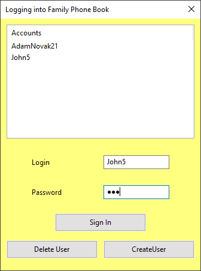
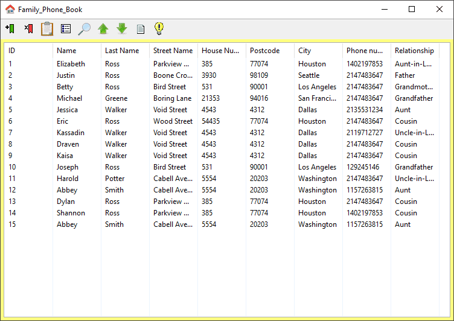
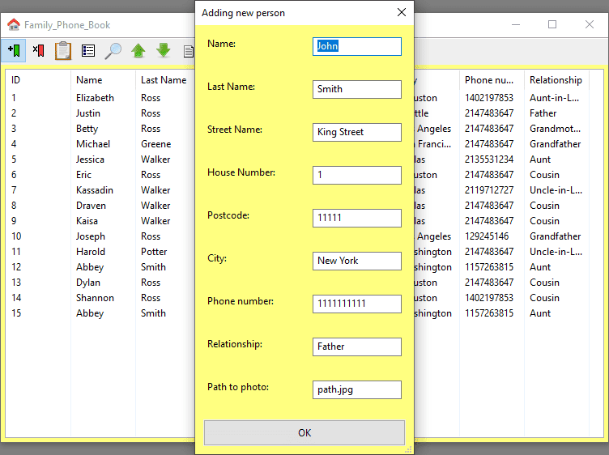
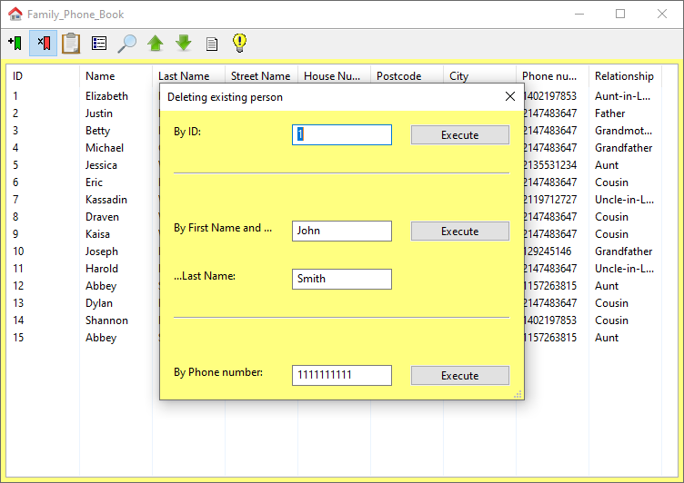
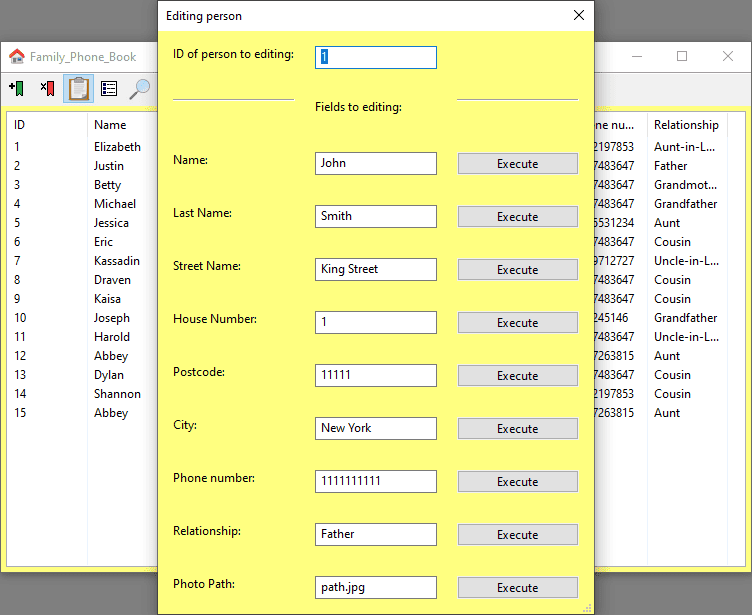
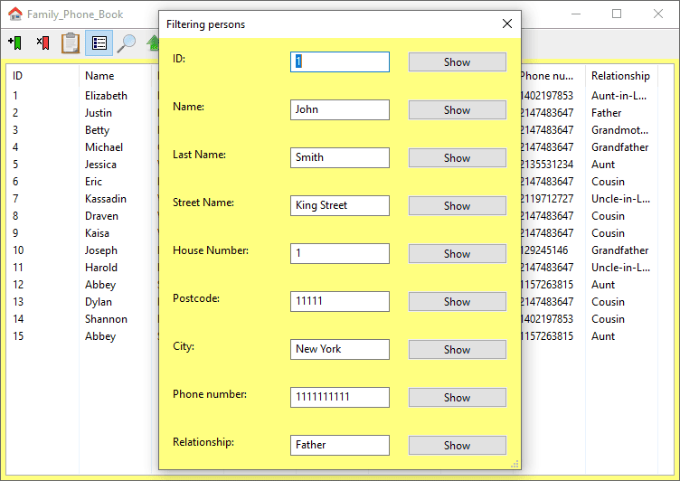
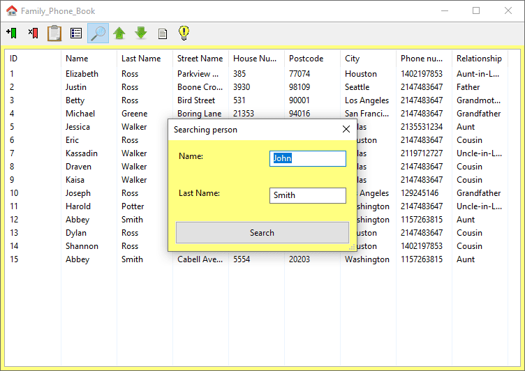
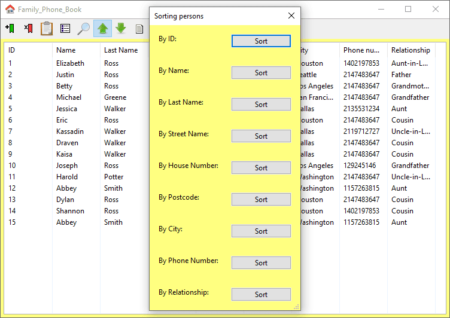
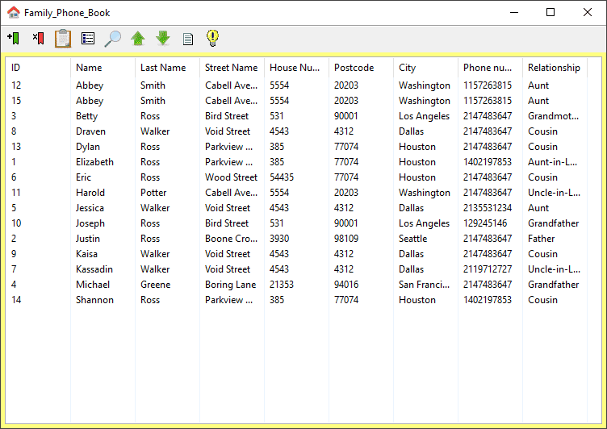
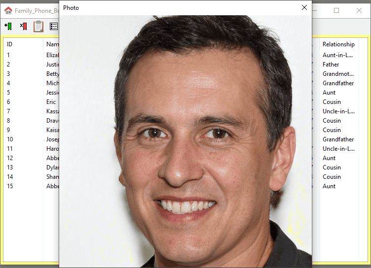

# Family Phone Book / Rodzinna Książka Telefoniczna

## EN

### Overview

Family Phone Book is a desktop application with a graphical user interface designed for managing contact information about family members and close acquaintances. It provides a convenient alternative to a traditional paper phone book, allowing users to store, browse, search, and modify contact records.
The application supports multiple user accounts, each with a separate contact database. Users can log in with their credentials and manage their own contacts. Contact information is stored in text files, allowing the data to be loaded when the application starts and saved after modifications.

### Features

- Create and delete user accounts.
- Log in to an account using a username and password.
- Maintain a separate contact database for each user.
- Add new contacts containing personal and address information, phone numbers, and relationship details.
- Edit selected contact fields using the contact ID.
- Delete contacts by ID, first and last name, or phone number.
- Display all contacts in a tabular view.
- Search for contacts by first and last name.
- Filter contacts by individual fields, including ID, name, address, phone number, and relationship.
- Sort contacts by selected fields in ascending or descending order.
- Display photos associated with individual contacts.
- Store contact and account information in text files.

### Screenshots

<br/>
<br/>
<br/>
<br/>
<br/>
<br/>
<br/>
<br/>
<br/>


### Technologies

- C++
- wxWidgets 3.0.5
- CMake
- NSIS
- Text file storage

### How to Run
1. Configure the project with CMake.
2. Build the `FamilyPhoneBook` target.
3. Run the executable from the build directory.

Example (Windows, PowerShell):
```powershell
cmake -S . -B build
cmake --build build --config Release
./build/FamilyPhoneBook.exe
```

## PL

### Opis

Rodzinna Książka Telefoniczna to aplikacja desktopowa z graficznym interfejsem użytkownika, przeznaczona do zarządzania danymi kontaktowymi członków rodziny oraz bliskich znajomych. Stanowi wygodną alternatywę dla tradycyjnej papierowej książki telefonicznej, umożliwiając przechowywanie, przeglądanie, wyszukiwanie i modyfikowanie informacji o kontaktach.
Aplikacja obsługuje wielu użytkowników, z których każdy posiada osobne konto oraz własną bazę kontaktów. Użytkownicy mogą logować się za pomocą loginu i hasła, a następnie zarządzać swoimi danymi. Informacje są przechowywane w plikach tekstowych, dzięki czemu mogą być wczytywane podczas uruchamiania programu i zapisywane po wprowadzeniu zmian.

### Funkcjonalności

- Tworzenie i usuwanie kont użytkowników.
- Logowanie do aplikacji za pomocą loginu i hasła.
- Prowadzenie osobnej książki telefonicznej dla każdego użytkownika.
- Dodawanie kontaktów zawierających dane osobowe, adresowe, numer telefonu oraz informacje o relacji z daną osobą.
- Edytowanie wybranych pól kontaktu na podstawie jego identyfikatora ID.
- Usuwanie kontaktów według ID, imienia i nazwiska lub numeru telefonu.
- Wyświetlanie wszystkich kontaktów w formie tabeli.
- Wyszukiwanie kontaktów według imienia i nazwiska.
- Filtrowanie kontaktów według poszczególnych pól, takich jak ID, imię, nazwisko, adres, numer telefonu czy stopień pokrewieństwa.
- Sortowanie kontaktów według wybranych pól rosnąco lub malejąco.
- Wyświetlanie zdjęć przypisanych do poszczególnych kontaktów.
- Przechowywanie informacji o kontach i kontaktach w plikach tekstowych.

### Screeny

<br/>
<br/>
<br/>
<br/>
<br/>
<br/>
<br/>
<br/>
<br/>


### Technologie

- C++
- wxWidgets 3.0.5
- CMake
- NSIS (Nullsoft Scriptable Install System)
- Przechowywanie danych w plikach tekstowych

### Uruchomienie
1. Skonfiguruj projekt za pomocą CMake.
2. Zbuduj cel `FamilyPhoneBook`.
3. Uruchom plik wykonywalny z katalogu `build`.

Przykład (Windows, PowerShell):
```powershell
cmake -S . -B build
cmake --build build --config Release
./build/FamilyPhoneBook.exe
```